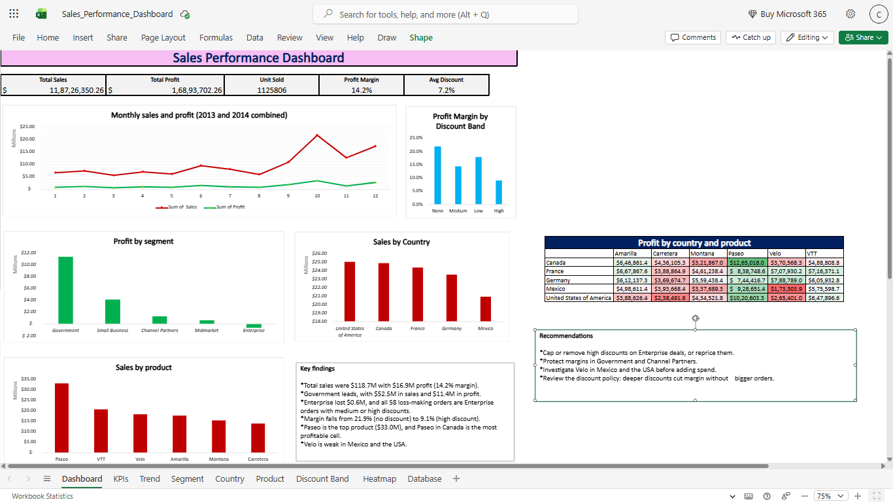

# Sales Performance Dashboard

An Excel dashboard analyzing 700 sales records across 5 segments, 5 countries and 6 products.

## Preview

## What it includes
- KPI cards: total sales, profit, units sold, profit margin, average discount
- Monthly sales and profit trend
- Breakdowns by segment, country, product and discount band
- Country-by-product profit heatmap

## Key findings
- Total sales of $11.87 crore and profit of $1.69 crore (14.2% margin).
- Enterprise lost $6.1 lakh; all 58 loss-making orders carried medium or high discounts.
- Profit margin falls from 21.9% (no discount) to 9.1% (high discount) without larger orders.

## Recommendation
Tighten the discount policy on Enterprise deals.

## Tools
Excel (PivotTables, PivotCharts, Conditional Formatting)

## Data
Microsoft's Financial Sample dataset (values in USD, shown in Indian number format).

## Files
- Sales_Performance_Dashboard.xlsx: full workbook
- Sales_Performance_Dashboard.pdf: PDF version# Sales-Dashboard-performance
